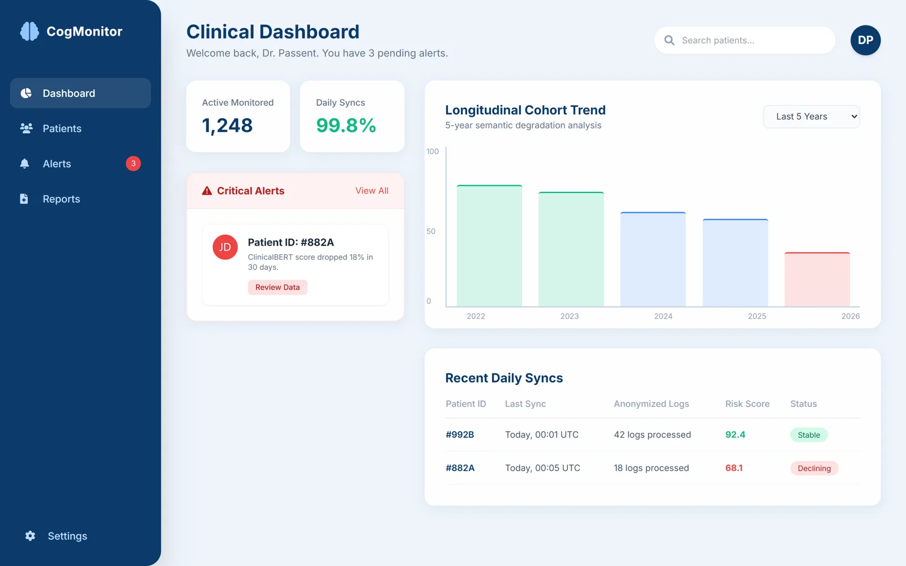
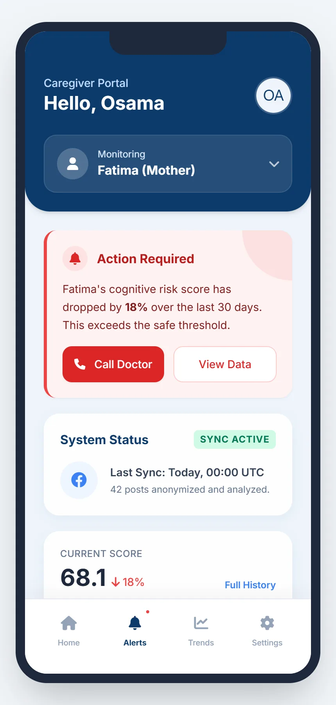
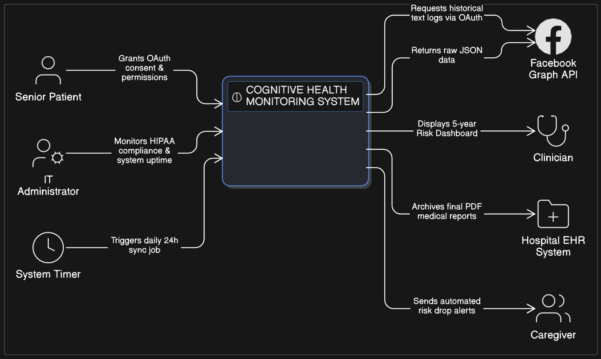
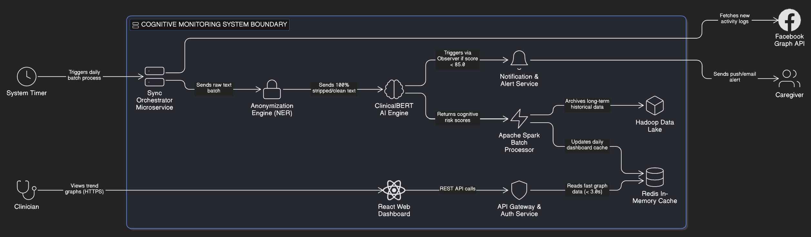
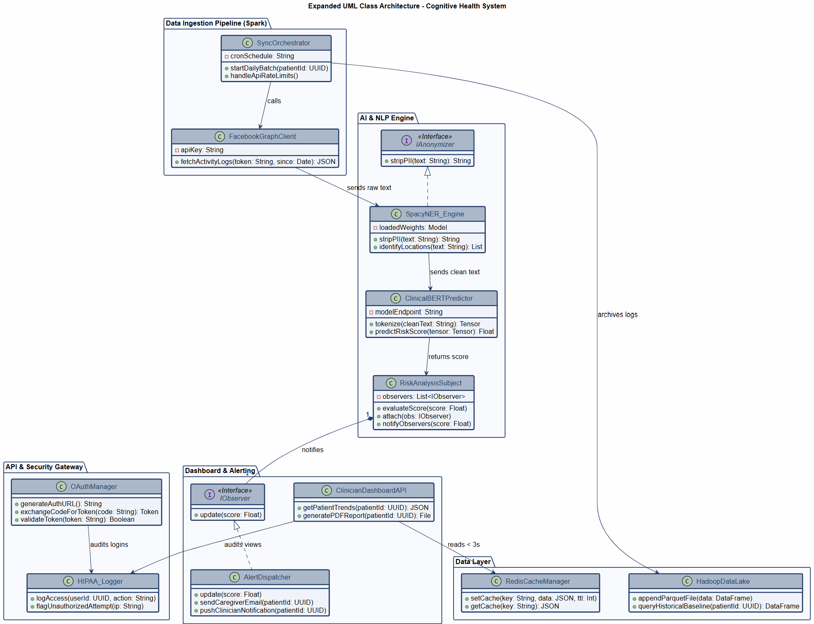
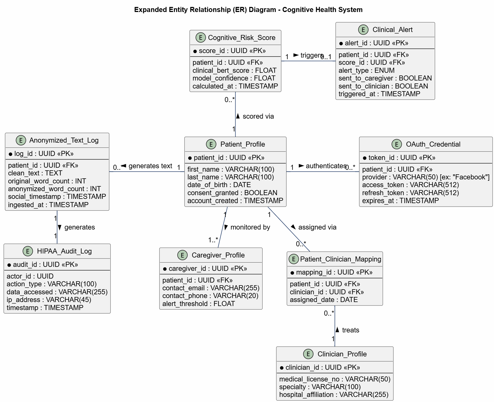

# Cognitive Health Monitoring System

The complete software design for a system that passively screens seniors for early signs of cognitive decline, from market study and requirements to architecture models and clickable prototypes.

Software Engineering (CS3151) final project, Effat University, Spring 2026.

> 📄 Case study: [osvr7.github.io/project.html?p=cognitive-health](https://osvr7.github.io/project.html?p=cognitive-health)

<p>
  
  
</p>

## The problem

Dementia is often diagnosed late because clinical memory tests are stressful, costly and infrequent. Families and doctors have no continuous, non-invasive signal between appointments.

## The proposed system

With the senior's consent, the system analyses their social-media writing over time for semantic signs of decline. Personal data is anonymised before analysis, risk is scored over time, clinicians see the trends, and caregivers are alerted when a score drops sharply.

> **Scope:** this repository contains the **design and prototypes**. The NER-based anonymisation and ClinicalBERT scoring are proposed components of the design. No model or backend was implemented in this project.

## What's in the specification

- Market study, Business Model Canvas and competitor analysis
- Personas, user stories, functional and non-functional requirements, and a requirements traceability matrix
- Five detailed use cases, each with use-case and sequence diagrams:
  1. Account management and consent
  2. Daily passive data sync
  3. Clinical dashboard and reports
  4. Automated risk alerts
  5. Security and compliance monitoring
- C4 system context and container diagrams, plus activity, UML class and entity-relationship models
- UI/UX prototypes, validation and acceptance criteria, and a project Gantt chart

📘 Full document: [`docs/software-requirements-and-design-specification.pdf`](docs/software-requirements-and-design-specification.pdf) (34 pages)

## Architecture

| System context (C4 level 1) | Containers (C4 level 2) |
|---|---|
|  |  |

| UML class diagram | Entity-relationship model |
|---|---|
|  |  |

## Prototypes

The prototypes are static HTML pages styled with Tailwind CSS (loaded from a CDN). Open them directly in a browser:

| File | What it shows |
|---|---|
| [`prototypes/clinician-dashboard.html`](prototypes/clinician-dashboard.html) | Desktop dashboard for neurologists: cohort trends, critical alerts, recent syncs |
| [`prototypes/caregiver-app.html`](prototypes/caregiver-app.html) | Mobile companion app for family caregivers: risk score, alerts, sync status |
| [`prototypes/project-gantt.html`](prototypes/project-gantt.html) | Project schedule |

## Project structure

```text
docs/
  software-requirements-and-design-specification.pdf
  diagrams/        Use-case, sequence, C4, activity, class, ER, canvas and Gantt diagrams
prototypes/        HTML prototypes
assets/screenshots/
```

## Team

**Osama Abutaha** · Hanan Idris · Talh Hossin
Instructor: **Dr. Passent Elkafrawy**, Effat University
